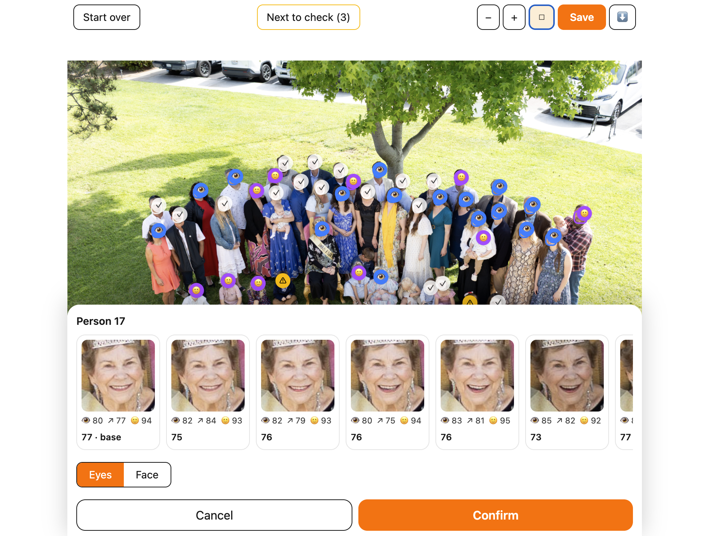

# 📸 KeeperShot

In almost every group photo someone blinks or looks away. Taking several shots helps, but rarely does a single frame have everyone at their best. KeeperShot fixes that turning a burst of near-identical group photos into one where everyone looks great. Private by design: everything runs in your browser. No uploads, no backend.



## How it works

1. **Add your burst**: drop in several shots of the same scene (JPEG, PNG or HEIC).
2. **Detect and group**: it finds every face and matches each person across frames.
3. **Auto-pick**: it scores each person's faces and picks the best one for everybody.
4. **Review**: change any pick if you disagree.
5. **Export**: faces are aligned and blended into a single final JPEG.

## Features

- 100% client-side: photos never leave your device
- Installable PWA
- Face detection with MediaPipe and alignment with OpenCV (WASM), all in a Web Worker
- Resume where you left off after a reload
- Manual override of any person's pick and of the base frame

## Quick start

```sh
npm install
npm run dev
```

Then open <http://localhost:5173>.

## Documentation

| Topic                                         | Doc                                          |
| --------------------------------------------- | -------------------------------------------- |
| Setup, commands, testing, debugging, renaming | [docs/development.md](docs/development.md)   |
| Deploying to GitHub Pages                     | [docs/deployment.md](docs/deployment.md)     |
| Pipeline, modules, coordinate spaces          | [docs/architecture.md](docs/architecture.md) |
| Full build spec and design decisions          | [docs/BUILD.md](docs/BUILD.md)               |
| Queued naming and performance work            | [docs/future-work.md](docs/future-work.md)   |
| Contributor and agent rules                   | [AGENTS.md](AGENTS.md)                       |


